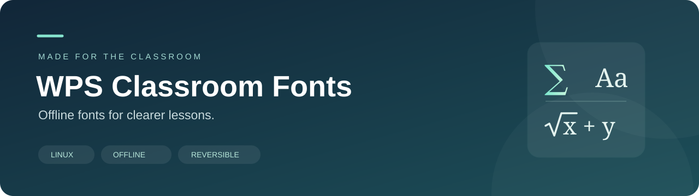

<div align="center">



**WPS 课件字体助手**

为麒麟 / Linux 上的 WPS 课件补充字体，让公式、符号和文字更容易正确显示。

[快速开始](#快速开始) · [安装与撤销](#安装与撤销) · [字体清单](docs/fonts.md) · [常见问题](docs/troubleshooting.md)

**离线运行 · 当前账号安装 · 分组撤销 · 文件校验**

[English guide](#english-guide)

</div>

---

## 它解决什么问题

从其他电脑复制过来的课件，可能出现数学符号变方框、英文字体被替换、中文排版变化。这个工具负责检查字体是否存在、安装准备好的字体，并在需要时按组撤销。

字体安装成功后，仍需重新打开 WPS，用原课件确认效果。图片里的文字、损坏的公式对象、旧格式兼容问题，不会仅靠安装字体修复。

| 能力 | 具体行为 |
| --- | --- |
| 一键安装 | 运行 `install.sh` 或 `install.desktop`，自动识别公开版或完整本地包 |
| 按组管理 | 数学与英语、常用中文、补充字体、课件补充分别安装和撤销 |
| 安装前检查 | 校验整组文件、识别字体、检查目标冲突，再开始复制 |
| 重复运行 | 完全相同的字体直接保留，不反复复制 |
| 可恢复撤销 | 只移动本工具管理的所选字体，备份后可重新安装 |
| 保护本地信息 | 日志留在账号缓存中，隐藏账号主目录和项目路径 |

## 快速开始

需要 **Linux、Bash 4+、Fontconfig、GNU coreutils 和 util-linux 的 `flock`**。常见麒麟桌面系统通常已有这些工具；脚本会提示缺少的命令。准备本地扩展字体和开发验证时另外需要 Python 3.9+。

1. 下载仓库 ZIP 并解压，或通过 Git 克隆。
2. 保存课件，完全退出 WPS。
3. 在解压后的文件夹中打开终端，运行：

```bash
bash install.sh
```

4. 安装完成后，重新打开 WPS 和原课件。

**公开下载版附带 9 个 STIX Two 开源字体文件。** 上面的命令会安装这些文件，提供 STIX Two Math 和 STIX Two Text。它们不会自动变成 Symbol、MT Extra 或宋体，工具也不会把替代字体误报成原字体。

**已经准备好完整 65 个字体的本地包**，同一命令会安装全部四组。文件只准备了一部分时，需要明确指定要安装的组，或先补齐本地字体。

也可以双击 `install.desktop`。首次使用时，文件管理器可能要求“允许启动”。双击 `.sh` 打开编辑器时，请选择“在终端中运行”，或使用上面的命令。所有运行文件均使用英文文件名。

## 安装与撤销

| 分组 | 字体文件数 | 安装 | 撤销 |
| --- | ---: | --- | --- |
| STIX Two 开源字体 | 9 | `bash install.sh open` | `bash undo.sh open` |
| 数学、英语和符号 | 48 | `bash install.sh math` | `bash undo.sh math` |
| 常用中文 | 5 | `bash install.sh chinese` | `bash undo.sh chinese` |
| 补充字体 | 5 | `bash install.sh extra` | `bash undo.sh extra` |
| 课件补充 | 7 | `bash install.sh lesson` | `bash undo.sh lesson` |
| 全部四组 | 65 | `bash install.sh all` | `bash undo.sh all` |

`open` 是 `math` 中的 9 个文件，**不额外计入总数**。撤销 `open` 也会移走 `math` 中相同的 STIX 文件。`math` 包含原有英语字体；撤销这一组会同时撤销这些英语字体。`chinese`、`extra`、`lesson` 可以独立操作。

新增的 `lesson` 组包含 6 种方正 GBK 字体及等线，完整文件约 **74.4 MiB**。原有 58 个文件全部保留。**NEU-BZ-S92 尚未取得完整文件，不在本包内**；`check.sh lesson` / `check.sh all` 会继续提示这一项，重复安装无法补齐。详见 [课件补充说明](docs/fonts.md#课件补充lesson)。

撤销必须明确写出分组；直接运行 `undo.sh` 只显示用法。图形入口位于 [`actions/`](actions/)。

```bash
bash check.sh          # 检查当前包对应的字体
bash check.sh all      # 检查完整配置要求的字体
bash check.sh chinese  # 只检查中文组
bash install.sh --help
```

检查按**字体家族**统计，安装按**字体文件**统计；一个 TTC 文件可能包含多个家族，两种数字不必相同。

## 准备其他字体

公开仓库仅附带允许随项目分发的 STIX Two。Symbol、MT Extra、Cambria Math、宋体等扩展字体的安装清单仍然保留，字体文件由使用者在本地准备。

将你有权使用的字体放在一个文件夹中，然后运行：

```bash
python3 tools/import-fonts.py /path/to/your-fonts
# 只准备中文组也可以：
python3 tools/import-fonts.py /path/to/your-fonts --group chinese
bash install.sh chinese
```

Windows 上准备离线包时可将 `python3` 换成 `py -3`，通过终端传入实际目录。准备完成后，再把完整项目文件夹复制到 Linux 电脑。

导入工具只接受 [`manifests/catalog.tsv`](manifests/catalog.tsv) 中校验值匹配的版本，不会联网抓取字体，不会把其他版本硬当成同一份文件。非开源扩展字体默认被 Git 忽略。详细组成和授权说明见 [字体清单](docs/fonts.md)。

## 安装位置与日志

- 字体：`${XDG_DATA_HOME:-$HOME/.local/share}/fonts/classroom-math-offline-v1/`
- 撤销备份：`${XDG_DATA_HOME:-$HOME/.local/share}/classroom-math-font-backups/`
- 操作日志：`${XDG_CACHE_HOME:-$HOME/.cache}/wps-classroom-fonts/logs/`

沿用旧版字体目录，方便管理之前安装的文件。安装及撤销限于当前账号，请直接运行，**不要使用 `sudo`**。数据和缓存目录须位于当前账号主目录内。

日志中的本机路径替换成 `<home>`、`<package>`，不记录账号名、主机名或课件内容。提交问题前仍请检查你附上的文字和截图。详见 [隐私与公开发布](docs/privacy.md)。

## 兼容与验证

面向麒麟 / Linux 桌面与 WPS 使用场景。字体文件本身不依赖 CPU 架构；脚本需要上面列出的系统工具。本仓库发布准备在 Ubuntu 的 Linux 环境中验证了真实 Fontconfig 安装、重复安装、分组撤销、失败保护和桌面入口解析。

这不代表所有麒麟版本、WPS 版本或每份课件的显示效果都经过测试。遇到问题请先查看 [排查指南](docs/troubleshooting.md)。

```bash
bash tests/integration.sh
python3 tools/verify-public.py
python3 tools/build-release.py
```

测试使用临时字体目录，不接触平时账号的字体。公开发布包只从经过检查的 Git 提交生成，不会把本地被忽略的字体或日志打进去。

## 目录

```text
install.sh / check.sh / undo.sh   安装、检查、撤销入口
actions/                         分组桌面入口
tools/                           安装逻辑、本地导入、公开检查和打包
manifests/                       字体校验值、名称与分组
fonts/Open-stix2-otf/             随仓库分发的 STIX Two
docs/                            使用、隐私、字体与发布说明
tests/                           隔离环境中的实际安装测试
licenses/                        第三方字体许可证
```

## 参与与授权

脚本及项目文档采用 [MIT License](LICENSE)；附带的 STIX Two 字体采用 [SIL Open Font License 1.1](licenses/STIX-OFL.txt)。第三方字体名称用于说明兼容目标，不代表与其厂商存在合作或背书。

欢迎改进脚本、文档与测试。提交前请阅读 [贡献指南](CONTRIBUTING.md)，不要将个人日志或未确认分发许可的字体提交到仓库。发布名称、简介、Topics、发布流程及更新说明已整理在 [GitHub 发布指南](docs/github-setup.md)。

## English guide

WPS Classroom Fonts is an offline font helper for WPS presentations and documents on Kylin and other Linux desktops. It installs fonts for the current user, checks exact file hashes before installation, preserves identical files on repeat runs, and moves selected fonts into a backup when undoing an installation.

The public package bundles **nine STIX Two files under SIL OFL 1.1**. These provide STIX Two Math and STIX Two Text; they do not replace missing Symbol, MT Extra, Cambria Math, or Chinese font families automatically. The 65-file profile supports additional, locally supplied fonts that the user is entitled to use. Those additional binaries are excluded from Git and public releases.

### Quick start

Requirements: Linux, Bash 4+, Fontconfig, GNU coreutils, and `flock` from util-linux. Python 3.9+ is needed for local font imports and development tests, but not for ordinary installation.

Extract the download, save your documents, close WPS, and run these commands as your normal desktop user:

```bash
bash install.sh       # Installs the nine public fonts, or all 65 in a complete local package.
bash check.sh         # Checks the font families for the detected package.
bash undo.sh open     # Moves the nine managed STIX fonts into a backup.
```

Do not run installation or undo with `sudo`. Reopen WPS and the original document to confirm rendering. Font installation cannot repair damaged equation objects, text inside images, or every document-format compatibility issue.

Groups are `open` (9 files), `math` (48, including `open`), `chinese` (5), `extra` (5), `lesson` (7), and `all` (65). Undo always requires an explicit group. A partially prepared package requires an explicit installation group as well.

The new `lesson` group adds six Founder GBK families and DengXian (74.4 MiB), preserving the original 58 files. **NEU-BZ-S92 is still unavailable and is not bundled.** Checking `lesson` or `all` reports it as missing unless it is already available in the current account. Installing again cannot supply a pending font.

To prepare fonts from an authorized local source:

```bash
python3 tools/import-fonts.py /path/to/your-fonts --group chinese
bash install.sh chinese
```

The importer accepts only versions matching the catalog's SHA-256 hashes and never downloads fonts. Fonts are installed beneath the current user's XDG data directory; logs remain in the XDG cache directory with home and package paths redacted. See [font scope](docs/fonts.md), [privacy](docs/privacy.md), and [troubleshooting](docs/troubleshooting.md).

### Development and releases

Run `bash tests/integration.sh` as a non-root Linux user. The suite isolates Fontconfig from normal user fonts and covers installation, repeat runs, undo, invalid files, desktop launchers, publication checks, and release packaging. See [test instructions](tests/README.md).

After committing the intended public files, run `python3 tools/build-release.py`. It audits the commit and creates a reproducible ZIP plus SHA-256 checksum. Ignored local fonts, untracked notes, and runtime logs are not included. Project code and documentation use MIT; bundled STIX Two fonts retain their separate OFL license.
